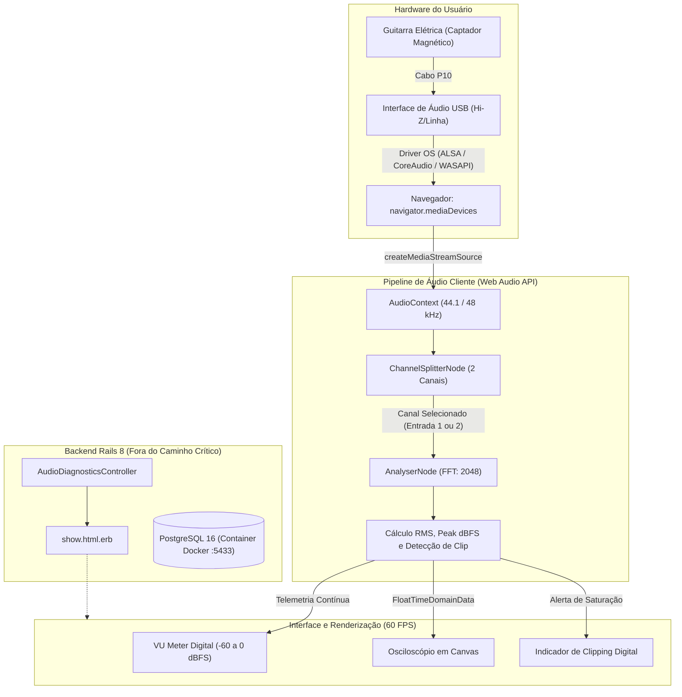
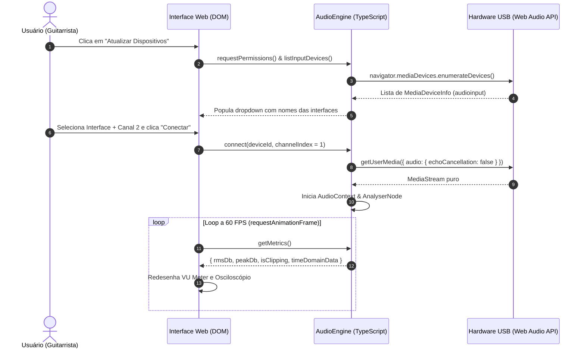

# Arquitetura Técnica — GuitarWeb

## 1. Visão Geral do Sistema

O **GuitarWeb** é uma aplicação web para aprendizado de guitarra com feedback visual e sonoro em tempo real. O produto é desenhado para operar inteiramente no navegador via Web Audio API, sem instalação de drivers proprietários ou softwares auxiliares no computador do usuário.

---

## 2. Decisões Arquiteturais e Isolamento de Responsabilidade

### 2.1 Separação Estrita de Áudio e Backend
* **Zero processamento de áudio no backend:** Todo o streaming e cálculo de amplitude/frequência ocorre localmente na máquina do usuário.
* **Segurança e Privacidade:** O sinal capturado nunca trafega pela rede, evitando vazamento de privacidade e eliminando gargalos de latência.
* **Papel do Rails:** Prover autenticação, servir a aplicação com Vite, armazenar configurações de ganho/latência e gerenciar arquivos privados de tablatura.

### 2.2 Seleção de Canal de Entrada de Hardware
Interfaces USB comuns de 2 canais (como Focusrite Scarlett 2i2, Behringer UMC202HD, EVO 4) costumam ter o pré-amplificador de instrumento/Hi-Z roteado para o **Canal 2** físico. Para evitar que a guitarra fique muda quando o navegador captura apenas o canal esquerdo (Canal 1), o pipeline implementa chaveamento com `ChannelSplitterNode`.

---

## 3. Fluxo de Dados de Áudio

---

## 4. Guia de Teste com Hardware Físico

1. Conecte a guitarra na entrada com a chave **INST** / **Hi-Z** ligada na interface USB.
2. Inicie a aplicação local e acesse `http://localhost:3000/diagnostics/audio`.
3. Selecione a interface USB no seletor de dispositivos.
4. Escolha o canal físico correto (Canal 1 para entradas frontais únicas ou Canal 2 para interfaces estéreo com instrumento no canal direito).
5. Clique em **"Conectar e Iniciar Teste"**.
6. Toque notas na guitarra e verifique a resposta em tempo real no VU meter e na forma de onda do osciloscópio.
