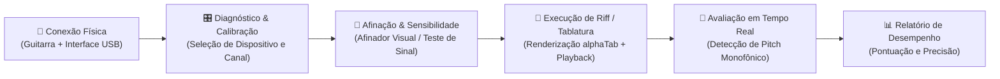

# 🎸 GuitarWeb

Aplicação web interativa para aprendizado e prática de guitarra elétrica com feedback visual e sonoro em tempo real. Inspirada na experiência intuitiva do Yousician, operando diretamente no navegador sem exigir softwares proprietários de áudio.

---

## 🧭 Fluxo de Negócio



---

## 🛠️ Tecnologias Utilizadas

* **Frontend:** TypeScript, Web Audio API, Canvas 2D, Vite 5.
* **Backend:** Ruby on Rails 8.1 (fora do fluxo crítico de áudio).
* **Banco de Dados:** PostgreSQL 16 (executado via Docker).
* **Testes & Qualidade:** RSpec (100% de cobertura nos controllers), Vitest, RuboCop, SimpleCov e Bundler Audit.

Mais detalhes de design técnico podem ser consultados no documento de [Arquitetura Técnica (ARCHITECTURE.md)](file:///home/ricardo/Documents/Projects/guitar-web/ARCHITECTURE.md) e na [ADR-001](file:///home/ricardo/Documents/Projects/guitar-web/docs/decisions/ADR-001-audio-pipeline-e-stack.md).

---

## 🚀 Como Executar Localmente

### 1. Iniciar o Banco de Dados (PostgreSQL no Docker)
O container do banco de dados está pré-configurado na porta `5433`:
```bash
docker compose up -d
```

### 2. Instalar Dependências
```bash
bundle install
npm install
```

### 3. Criar e Preparar o Banco
```bash
bin/rails db:prepare
```

### 4. Iniciar o Servidor de Desenvolvimento
```bash
bin/vite dev &
bin/rails server
```
Acesse `http://localhost:3000` no seu navegador.

---

## 🧪 Suíte de Testes e Validação

Para rodar todos os testes automatizados do projeto:

```bash
# Testes do Backend (RSpec + SimpleCov)
bundle exec rspec

# Testes do Pipeline de Áudio (Vitest)
npm test

# Validação Estática de Tipos (TypeScript)
npm run typecheck

# Validação de Estilo de Código (RuboCop)
bundle exec rubocop
```
